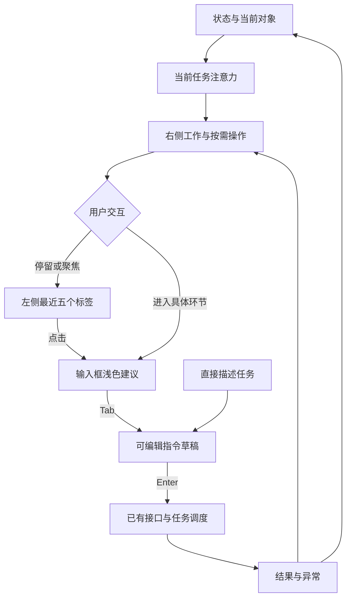

# 对话工作台：设计冻结与首个开发样本

冻结日期：2026-11-14。用户已授权在 fork 的独立前端设计分支开始样本开发。

分支：`design/conversation-workspace`。基线：`6c014c9f0050cc5d12baec2065798d3fe06fb6a2`（用户 fork 当前 main）。生产桌面前端和宿主行为尚未修改。

## 已冻结的交互方案 0.4

- 常驻布局只有左侧对话、右侧工作，以及顶部“状态—对象—注意力”栏。右侧工作内部允许原图/原文与翻刻/译文同屏。
- 简洁版和专业版共享任务、对象、选区和版本。复杂功能按层次出现，不能通过增加常驻按钮来承载所有能力。
- 开始工作前只涉及导入、工作入口和 Agent 配置；进入具体任务后才显露相关操作。菜单通过悬停、键盘聚焦、右键或具体对象交互展开，触控提供等价入口。
- 大注意力对应当前任务，如翻刻、翻译、目录整理、证据检索。切换任务必须保留草稿、页面和版本；用户可锁定注意力，锁定时不自动改换中心。
- 小注意力来自对象区域的有效停留、聚焦或进入环节。建议停留阈值为 400 ms，避免鼠标经过即触发。左侧最多显示五个标签，按首次进入顺序 FIFO；重复关注同一上下文不调整顺序，第六个新标签挤出最早的标签。
- 标签绑定场景、文献、页码和版本；旧标签不可暗中改指新对象。切换上下文后应标为过期或明确重新绑定。
- 进入具体环节或点击标签，在左侧输入框显示浅色建议。Tab 只接受建议，Enter 才发送。保留不匹配的已有草稿；选择文本、输入法组合输入、Shift+Tab 以及编辑器本身的导航不能被接管。Escape 可取消建议。
- 对话与直接操作应走同一业务入口。Agent 可组合平台已有功能完成模糊指令，但不能把界面脚本中的固定回复称作真实 Agent 推理。
- 原文、机器结果、人工修订、来源版本分别保留。任务“已受理”、运行“已结束”、页面“已提交”和内容“已核对”是不同事实。



冻结备份：`Patchouli_Interaction_Design_Backup_20261114.zip`。

SHA-256：`d8ada40b4fad30566044256d50d0a8a6bea1b22ebb4baa58c0acee967ee95470`。

备份包含设计说明、交互图、0.4 原型完整文件和逐文件哈希清单。旧原型的 95 项检查属于状态/处理器验证，不是浏览器测试，也不是宿主联调验收。不得用旧原型的验证结果替代新样本的验证。

## 第一条开发切片

`samples/conversation-workspace/` 是独立静态样本，保留已经认可的双区、紫灰配色、渐进展示与提示词补全。为先建立可验证的接口边界，首个切片收窄为单页、单个正文 leaf box：

导入示例 PDF → 读取原文 → 发现翻译控制端点 → 启动翻译 → 查询运行 → 获取译文 → 人工修改 → 带版本条件提交。

未移植进首个切片的旧演示场景仍保存在冻结原型中。专业模式、真实 Agent 会话、目录扫描、多页与多框编辑、OCR、元数据、检索与摘录要在各自接口审计后逐步加入；当前样本不显示没有执行契约的伪功能按钮。

## 真实接口依据

| 用户操作 | 已有接口 | 源码依据 |
|---|---|---|
| 导入 PDF | `patchouli.add {path, kind:"pdf"}` | `src/Patchouli.Mcp/McpCommands.cs` 的 McpAddRequest/McpAddResult；McpCommandService.AddAsync |
| 读取原文 | `patchouli.fetch {uris:["patchouli://texts/{UUID}/page-1.xml"]}` | `McpCommandService.cs`；`PageXmlCodec.EncodePage` |
| 发现可用翻译动作 | fetch `patchouli://runs/translation/control` | `src/Patchouli.Mcp/McpCommandService.Actions.cs` 的 FetchEndpointDescriptionAsync |
| 开始翻译 | `patchouli.send`，endpoint/action/target/args/request_id | `.agents/protocols/mcp-protocol.md` 第 11 节；`src/Patchouli.Host/Translation/TranslationRunService.cs` |
| 查询翻译状态 | fetch 回执中的 `status_uri` | `src/Patchouli.Mcp/McpRunDtos.cs`；McpCommandService 的 FetchTranslationRunStatusAsync |
| 读取译文 | fetch `patchouli://translations/{UUID}/page-1.xml` | `src/Patchouli.Infrastructure/Documents/PageXmlCodec.cs` |
| 保存人工修订 | `patchouli.put {uri, source_revision, translation_version, boxes}` | `src/Patchouli.Mcp/IMcpWriteApi.cs`、McpCommands、PageXmlCodec.DecodeBox |

所有调用指定 `format:"json"`。基线 MCP transport 实际返回 `content:[{type:"text",text:JSON}]`；适配器也能接受外层提供的 `structuredContent`。响应必须有 `meta.outcome:"success"`，保留部分 entries 的错误回执不构成成功。

`core.js` 的 `Client(callTool)` 是可替换传输边界；回调接收 `{name, arguments}`，返回 MCP CallToolResult。当前页面只装配 `fixture.js` 的合成响应；没有建立 MCP 网络连接，没有本地文件访问，没有 API key，也没有 Agent 会话。真实接入时由宿主集成层提供已有授权传输、真实路径和生命周期，不能让网页凭猜测访问端口或持有宿主凭据。

演示的 `patchouli://` UUID 和 `/sample/education.pdf` 均为固定合成标识，不是用户真实文献或可引用史料。fixture 只覆盖此切片消耗的字段和动作，不能作为完整 MCP 服务器实现或服务端契约测试替身。

## 写入与错误边界

- 一基物理页码；写入必须使用不含 rev/box 查询选择器的规范页面 URI。
- 先完整获取 XML；截断、逐项错误、错误 envelope、身份不一致均不得进入可保存状态。
- 以完整 `<box>` 元素提交，保留结构属性与稳定 id，只更新正文 payload 和 translated 标记。
- 保存带读取时的 source_revision 与 translation_version，只有 committed=true 的回执才显示已保存。
- 版本冲突保留草稿，禁止自动覆盖或自动重试；显式重新读取后显示当前已保存文本供人工核对，再允许提交。
- 翻译受理后轮询 status_uri；completed 且部分页面 failed/partial 不显示全部成功。首个切片最多自动轮询八次，仍在运行时转为用户触发继续查询，不把超时等待伪装成任务失败。
- 单页复杂层次、多个 leaf、只读或 suppressed box 在此样本拒绝编辑，后续扩展不得丢弃结构。
- 暂无取消、恢复与自由任务规划界面；这些能力没有被本样本宣称为完成。

## 运行与验证

直接用浏览器打开 `samples/conversation-workspace/index.html`，无需服务器或依赖安装。生成单文件预览：

```sh
python3 scripts/build-frontend-sample.py
```

产物：`.tmp/frontend-sample/Patchouli_Frontend_Sample.html`。右上角“样本模式”按需打开请求/回执和错误演练。

```sh
node scripts/verify-frontend-sample.cjs
```

已通过 20 项 Node 适配器、状态规则与静态结构检查，覆盖端到端模拟调用顺序、格式、版本前置条件、失败回执、截断、部分任务、标签 FIFO/过期、输入法与草稿保护。未完成真实浏览器视觉/交互检查，也未完成真实宿主集成测试。

按仓库要求实际尝试了 `scripts/inspect-code.ps1`，但当前环境拒绝 InspectCode 的本地 socket 与用户目录写入，停在 solution build，运行已中止。尚未得到合格 SARIF，不能声明 .NET 检查通过。

2026-11-15，用户进一步澄清“.NET 不必提交，这个只是代码库编译的结果而已”。本轮按独立前端样本的范围提交，作为此次 .NET 检查的范围例外；验证依据为上述 20 项前端检查，不修改仓库的一般检查规则。提交仅包含 HTML/CSS/JavaScript 源码、Python 打包脚本、Node 验证脚本和本设计说明，不包含 .NET SDK、bin/obj、DLL、应用包、ZIP、生成预览或日志。后续改动正式桌面前端或宿主时，仍按仓库规则执行相应编译、检查和测试。
